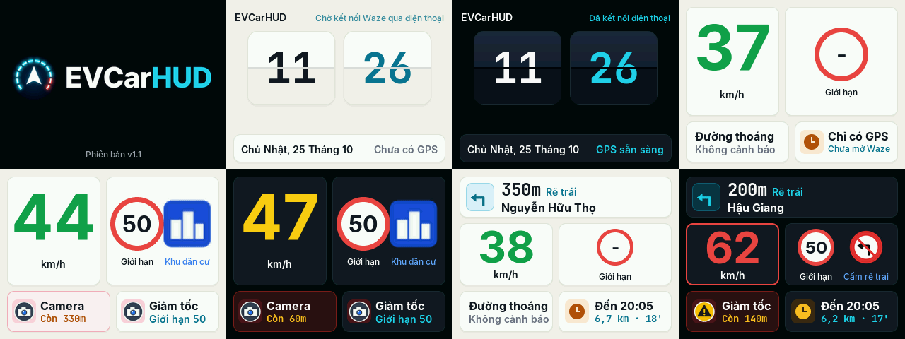

# EVCarHUD cho board ESP32-2432S028 (2.8" 320x240)

Firmware HUD cho board "Cheap Yellow Display" ESP32-2432S028 (ESP32-WROOM, màn 2.8" ILI9341/ST7789, cảm ứng XPT2046).
Điện thoại chạy **Waze Mod** gửi dữ liệu dẫn đường (giao thức HLP/1) qua **Bluetooth LE**, HUD giải mã và hiện giao diện dạng thẻ giống bản mô phỏng trên evcarhud.com:



- **Màn chờ** (chưa có dữ liệu, hoặc đứng yên 30 giây khi không dẫn đường): chưa kết nối điện thoại thì là đồng hồ điện tử 24 giờ (HH:MM, dấu ":" nhấp nháy), đã kết nối thì là đồng hồ lật; kèm ngày tháng và dòng "Chờ kết nối Waze qua điện thoại" hoặc "Đã kết nối điện thoại". Board không có pin giữ giờ: đồng hồ chạy tiếp từ giờ đã lưu lần trước (mới nạp firmware thì từ giờ build), góc dưới ghi "Giờ chưa chỉnh"; điện thoại kết nối là giờ được chỉnh đúng và lưu lại 10 phút/lần.
- **Chạy thường** (đang chạy, chưa đặt lộ trình): tốc độ số lớn bên trái, biển giới hạn + biển báo bên phải, cảnh báo và lời nhắc ở dưới. Chưa mở Waze (chỉ có tốc độ GPS): biển giới hạn hiện "-", thẻ cảnh báo "Đường thoáng".
- **Dẫn đường**: thẻ rẽ ở trên, tốc độ và biển báo ở giữa, cảnh báo và giờ đến ở dưới.
- Thẻ dẫn đường: mũi tên rẽ, khoảng cách, kiểu rẽ, tên đường, thẻ "Tiếp theo".
- Tốc độ hiện tại: xanh lá, vàng khi cách giới hạn ≤ 5 km/h, đỏ khi vượt (kèm viền đỏ nhấp nháy, LED đỏ, loa kêu 2 tiếng).
- Biển giới hạn tốc độ và biển báo gần nhất (khu dân cư, cấm vượt, cấm rẽ...).
- Cảnh báo gần nhất (cảnh sát, camera, tai nạn, kẹt xe...) và giờ đến, quãng đường còn lại.
- Khởi động: hiện logo EVCarHUD 3 giây (kèm phiên bản) rồi vào màn hình dẫn đường.
- Ban ngày / Ban đêm: chạm màn hình hoặc bấm BOOT để đổi Tự động → Ngày → Đêm (tự động theo giờ điện thoại, 6:00–18:00 là ngày).
- **Xoay màn hình 180°** (mặc định đã xoay sẵn cho đúng chiều khi lắp trong vỏ): giữ tay trên màn hình 1 giây, hoặc bấm nút BOOT 2 lần liên tiếp (dùng khi lắp board ngược trong vỏ). Board nhớ hướng cho lần sau.

## 1. Cài ESP-IDF (một lần)

Cài **ESP-IDF 5.3 trở lên** bằng bộ cài Windows: https://dl.espressif.com/dl/esp-idf/ (chọn bản 5.3.x hoặc 5.4.x).
Sau khi cài, mở **ESP-IDF 5.x CMD** (hoặc PowerShell) từ menu Start.

## 2. Build

```bat
cd H:\Projects\ECarHUD_S3
idf.py set-target esp32
idf.py build
```

Lần đầu `idf.py` tự tải LVGL và driver màn hình/cảm ứng (cần mạng).

## 3. Nạp

**Cách 1 – cắm USB nạp thẳng** (thay `COM5` bằng cổng của board):

```bat
idf.py -p COM5 flash monitor
```

**Cách 2 – nạp qua trang web evcarhud.com**: gộp thành 1 file rồi tải lên trang `/admin` với địa chỉ nạp **0x0**:

```bat
idf.py merge-bin -o evcarhud-full.bin
```

File nằm ở `build\evcarhud-full.bin`.

**Không cài ESP-IDF cũng được**: mỗi lần đẩy code lên nhánh `main`, GitHub tự build (mục **Actions → Build firmware**) và đặt file `evcarhud-2.8-<commit>.bin` vào bản phát hành **ban-moi-nhat** (mục **Releases** của repo). Tải file đó rồi đưa lên `/admin`, địa chỉ 0x0.

## 4. Lần chạy đầu: màn kiểm tra màu

**Màn hình nhiễu / sọc / không ra 4 ô màu?** Là sai chip màn hình. Firmware mặc định dùng **ST7789** (board 2 cổng USB-C + micro, mặt sau ghi TPM408-2.8); board cũ 1 cổng micro USB dùng ILI9341. Đổi không cần build lại: cắm điện, đợi khoảng 1 giây tới khi **đèn LED nhấp nháy xanh dương**, bấm **BOOT** một lần → loa kêu "tít", board khởi động lại với chip còn lại (nhớ luôn cho lần sau). Bấm lại lần nữa để quay về.

Khi khởi động, màn hình hiện 4 ô: **ĐỎ** (trên trái), **XANH LÁ** (trên phải), **TRẮNG** (dưới trái), **XANH DƯƠNG** (dưới phải), và LED nháy đỏ → xanh lá → xanh dương.
Nếu sai, mở `idf.py menuconfig` → **EVCarHUD → Man hinh**:

| Hiện tượng | Sửa |
|---|---|
| Màn trắng / nhiễu / không hiện gì | Bấm BOOT khi LED nhấp nháy xanh dương (xem trên), hoặc đổi chip **ILI9341 ↔ ST7789** trong menuconfig |
| Đỏ và xanh dương đổi chỗ | Bật/tắt **Thu tu mau BGR** |
| Màu như ảnh âm bản | Bật/tắt **Dao mau** |
| Hình bị lật ngang / dọc | Bật/tắt **Lat ngang** / **Lat doc** |
| Không cần màn kiểm tra nữa | Tắt **Man kiem tra mau** |

Sửa xong chạy lại `idf.py build flash`.

## 5. Kết nối Waze Mod

Trên điện thoại: **Waze Mod → HUD → Bluetooth LE**, chọn thiết bị **EVCarHUD**. Chưa kết nối thì màn hình hiện màn chờ đồng hồ với dòng "Chờ kết nối Waze qua điện thoại"; điện thoại nối Bluetooth xong đổi thành "Đã kết nối điện thoại".

## 6. Chế độ trình diễn (không cần điện thoại)

Giữ nút **BOOT 3 giây**: bật/tắt chế độ trình diễn (dữ liệu giả, chạy đúng kịch bản "Chạy thử" trên evcarhud.com, mỗi mục Ngày rồi Đêm: logo → 1 chưa kết nối điện thoại (đồng hồ điện tử 24 giờ) → 2 đã kết nối (đồng hồ lật) → 3 Ngày/Đêm/Tự động → 4 chạy chưa có Waze → 5 chạy có Waze → 6 chỉ đường chưa có Waze → 7 chỉ đường có Waze. Tên mục hiện ở giữa màn hình 2 giây), board tự khởi động lại. Dùng để trưng bày hoặc kiểm tra màn hình.

## Chân GPIO (mặc định)

| Phần | Chân |
|---|---|
| LCD (SPI2) | SCLK 14, MOSI 13, MISO 12, CS 15, DC 2, đèn nền 21 |
| Cảm ứng XPT2046 (SPI3) | SCLK 25, MOSI 32, MISO 39, CS 33 |
| LED RGB | 4 / 16 / 17 (mức thấp là sáng) |
| Loa | 26 |
| Quang trở (tùy chọn) | 34 |

Đổi chân trong `idf.py menuconfig` → **EVCarHUD → Chan GPIO**.

## Cho người phát triển

- `main/dashboard.c`: giao diện (LVGL 9), chỉ nhận dữ liệu qua các hàm `ui_set_*`.
- `main/dashboard_hlp.c`, `main/hlp.c`: giải mã HLP/1 của Waze Mod. `main/ble_link.c`: Bluetooth LE (NimBLE).
- `main/board.c`: màn hình, cảm ứng, đèn nền, LED, loa.
- `tools/pc_preview/build.sh`: chụp ảnh giao diện trên PC (Linux/WSL), không cần board.
- `tools/fonts/gen_fonts.sh`: tạo lại font (Inter, JetBrains Mono) – cần Node.js.
